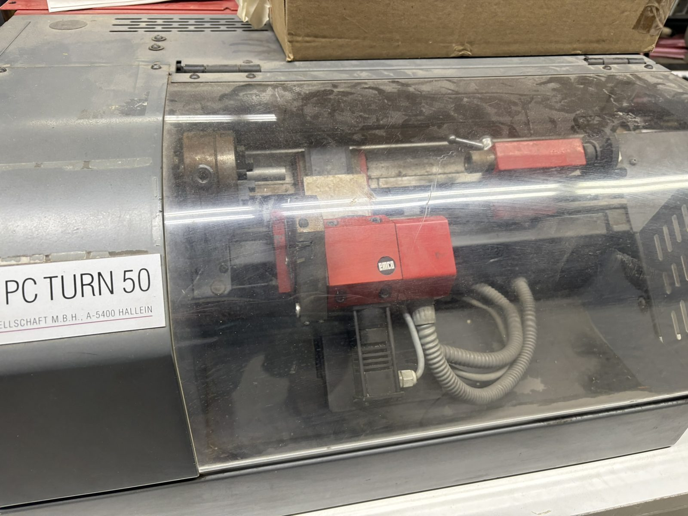

# 00 — Overview: the EMCO PC TURN 50 at MakeICT

This is the front door to the documentation for MakeICT's **EMCO PC TURN 50**, a small Austrian
benchtop CNC lathe from the early 1990s (EMCO Maier Ges.m.b.H., Hallein, Austria). Everything
here was reconstructed from 301 photographs of the machine, its binders and its complete
electrical documentation — see [`90-photo-index.md`](90-photo-index.md).



## Status, in one paragraph

**The machine cannot currently be driven.** It was designed to be run by a DOS PC through a
proprietary memory-mapped ISA card (`Y4A013000`) speaking an undocumented protocol over RS-485.
That PC and card are gone, and the protocol is unknown — recovery work is tracked in
[`30-serial-protocol.md`](30-serial-protocol.md), and it may not succeed. The lathe itself is
mechanically intact and its control cabinet is believed functional but unverified. Until the
protocol is recovered or a retrofit ([`60-retrofit-design.md`](60-retrofit-design.md)) is
executed, all "operation" happens in the **LinuxCNC training simulator**
([`70-simulator.md`](70-simulator.md)) and the browser sender's simulated mode (`sender/`).
Do not walk to the lathe expecting to cut a part today.

## How the pieces connect

```
   DOS PC (gone)                     red control cabinet                    lathe
  ┌────────────────┐                ┌──────────────────────┐          ┌───────────────┐
  │ FANOT software │   RS-485 bus   │ X300 (rear DB9)      │          │ 2× 5-phase    │
  │ (full Fanuc-0T │  3-wire, via   │   │                  │  motor,  │ stepper (X,Z) │
  │ interpreter)   │◄──proprietary──┤ CPU  Y4A012000       │  sensor  │ spindle motor │
  │                │  ISA card      │ PLC  Y4A011000       │◄─cables─►│ + encoder     │
  │ ISA Y4A013000  │  Y4A013000     │ steppers Y4A018000   │          │ turret motor  │
  │ (memory-mapped,│  (NOT RS-232,  │ spindle FRC105       │          │ ref/sync      │
  │  gone)         │  NOT G-code)   │ turret Y4A017000     │          │ switches      │
  └────────────────┘                └──────────────────────┘          └───────────────┘
```

The cabinet is a complete CNC executor in its own right, not a motor amplifier: the DB9 carried
a proprietary device bus, not a G-code stream. That single fact shapes the whole project —
[`20-control-architecture.md`](20-control-architecture.md) is the standing explanation of why
**LinuxCNC cannot drive this machine over its serial port**.

## Reading paths

| You are… | Read, in order |
| --- | --- |
| A member who wants to learn the lathe | [`40-operator-guide.md`](40-operator-guide.md) → [`70-simulator.md`](70-simulator.md) → [`50-gcode-reference.md`](50-gcode-reference.md) |
| Looking up a spec, alarm code or part number | [`10-machine-reference.md`](10-machine-reference.md) |
| Wondering "why not just plug LinuxCNC into the DB9?" | [`20-control-architecture.md`](20-control-architecture.md) |
| Working on the protocol or the sender | [`30-serial-protocol.md`](30-serial-protocol.md), then `sender/INTERFACE.md` |
| Planning the retrofit | [`60-retrofit-design.md`](60-retrofit-design.md) |
| Fixing something | [`80-maintenance.md`](80-maintenance.md) |
| Hunting for a source photograph | [`90-photo-index.md`](90-photo-index.md) |

## A note on trust

Facts in these documents carry source tags: **[PLATE]** read off the machine or a board,
**[SCHEM]** from an EMCO schematic, **[MANUAL]** from EMCO printed documentation,
**[UNVERIFIED]** inferred and not yet confirmed at the machine. Nothing tagged
**[UNVERIFIED]** should be treated as fact — and if you confirm one at the machine, correcting
the tag is the most useful contribution you can make.
