# 10 — Machine reference: EMCO PC TURN 50

The consolidated reference for this machine, so the paper binders become optional. Everything
here was recovered from photographs of the machine, its manuals and its complete electrical
documentation ("ELEKTRISCHE DOKUMENTATION EMCO PC TURN 50, Edition 93-5, VS 4301") — sources are
indexed in [`90-photo-index.md`](90-photo-index.md), and the underlying fact sheet is
[`_machine-facts.md`](_machine-facts.md).

**Source confidence tags**, used on every number:

- **[PLATE]** — read off the machine's own type plate or a board silkscreen
- **[SCHEM]** — read off an EMCO schematic sheet
- **[MANUAL]** — stated in EMCO printed documentation
- **[UNVERIFIED]** — inferred, or not yet confirmed against the physical machine

Anything **[UNVERIFIED]** is not a fact. If you confirm one at the machine, fix the tag here.

---

## 1. Identity

| Item | Value | Source |
| --- | --- | --- |
| Model | EMCO PC TURN 50 | [PLATE] |
| Maker | EMCO Maier Ges.m.b.H., A-5400 Hallein, Austria | [PLATE] |
| Control | DOS PC running EMCO "Control System GE FANUC Series 0-TC" (Fanuc-0T emulation), v2.0, 1993 | [MANUAL] |
| Control box label | `A6M 311 000 06G` "G.E-KASTEN" | [PLATE] |
| Dimensions | 840 × 695 × 345 mm [33.1 × 27.4 × 13.6 in] | [MANUAL] |
| Mass | 85 kg [187 lb] | [MANUAL] |
| Serial number / year | **illegible in every photograph — read it off the machine** (plate is below the key switch) | [UNVERIFIED] |

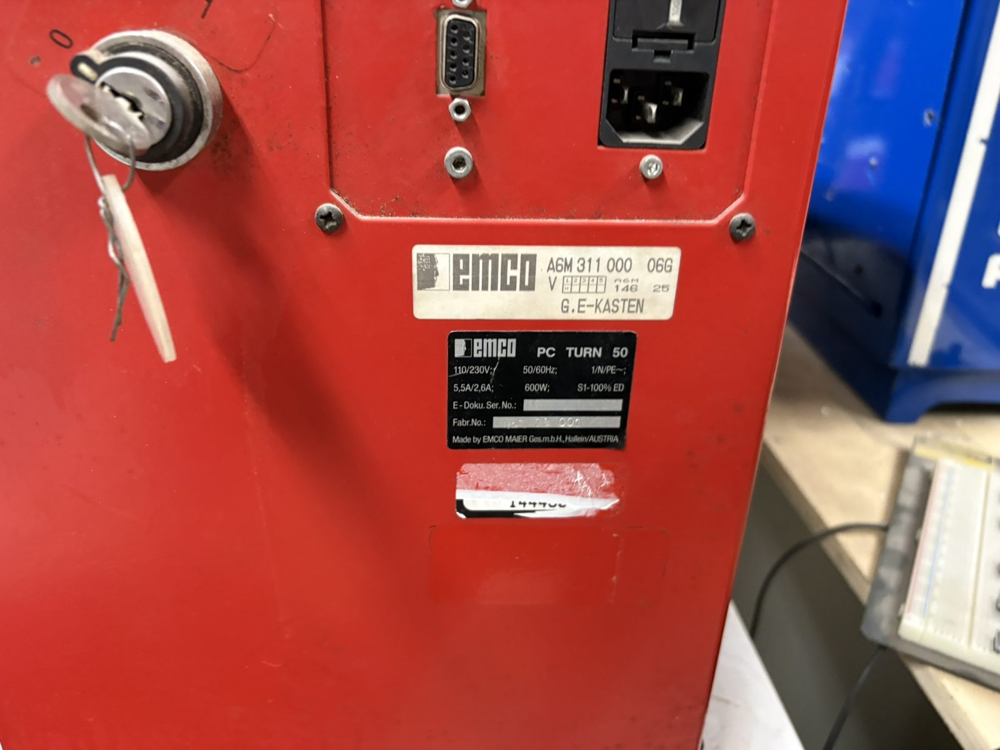

## 2. Power and electrical

| Item | Value | Source |
| --- | --- | --- |
| Supply | 100/110/230 V, 50/60 Hz, 1/N/PE~ | [PLATE] |
| Current | 5.5 A @ 110 V / 2.6 A @ 230 V | [PLATE] |
| Connected load | 0.6 kVA; rated power 600 W, S1 100 % ED | [PLATE] |
| Back-fuse | max 6.3 A slow | [MANUAL] |
| Voltage selection | selector pin at the fuse holder — 110 V mains → "100", 230 V → "220"; true 100 V needs the transformer's blue core wire moved to "−5 %" | [MANUAL] |
| Transformer | 600 VA, primary taps 100/120/220/240 V, secondary 18 V 7 A | [SCHEM] |
| 24 V rail | 18 V → bridge rectifier → 15000 µF / 40 V reservoir → 24 VDC bus | [SCHEM] |
| Fuses (mounting panel) | F1 2.5 A T (SPS outputs), F2 2.5 A T (SPS inputs), F3 2.5 A T (axis controller), F4 6.3 A T (24 V supply); mains 6.3 A T at the IEC inlet | [SCHEM] |
| Contactors | 2× ABB BC6-30-01, 24 VDC coils, switching 230 V to the spindle inverter | [SCHEM] |
| Cooling | 2× Papst 4580N fans, 230 VAC 0.125 A | [SCHEM] |

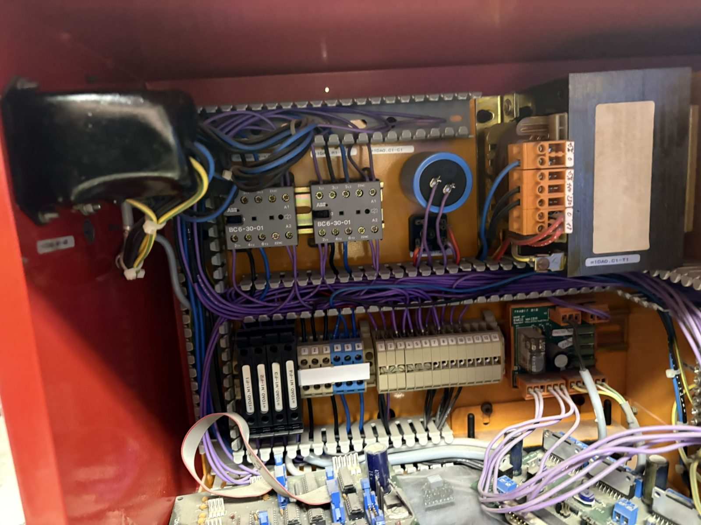
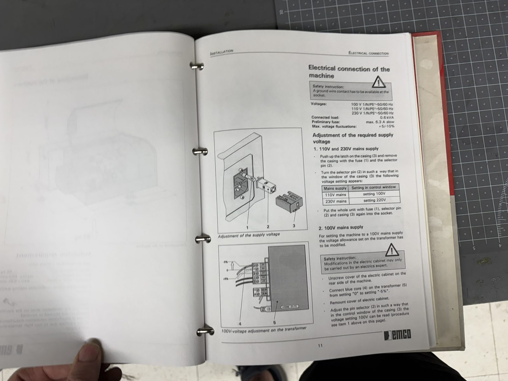

## 3. Travels, feeds, resolution

| Item | Metric | Imperial | Source |
| --- | --- | --- | --- |
| X travel (usable) | 48 mm | 1.89 in | [MANUAL] |
| Z travel (usable) | 228 mm (275 mm mechanical) | 8.97 in (10.83 in) | [MANUAL] |
| Centre height | 65 mm | 2.56 in | [MANUAL] |
| Distance between centres | 300 mm | 11.8 in | [MANUAL] |
| Swing over bed | ø130 mm | ø5.0 in | [MANUAL] |
| Swing over cross slide | ~ø60 mm | ~ø2.36 in | [MANUAL — low-confidence reading] |
| Input resolution | 0.001 mm | 0.0001 in | [MANUAL] |
| Minimum travel increment | 0.0025 mm | 0.000098 in | [MANUAL] |
| Working feed | 0–750 mm/min | 0–30 in/min | [MANUAL] |
| Rapid traverse | 750 mm/min | 29.5 in/min | [MANUAL] |
| Mechanical feed maximum | 1500 mm/min | 59 in/min | [MANUAL] |
| Max feed force | ~600 N (valid to 500 mm/min) | ~135 lbf | [MANUAL] |

Note the two "resolution" rows are both from EMCO pages and differ: the software accepts
0.001 mm input, but the smallest physical movement is 0.0025 mm (consistent with 1000 steps/rev
on the leadscrew pitch). Which travel figure (8.97 in vs 11.8 in) pairs with which table row in
the US binder should be re-checked against the original page — the metric manual's 228/48 mm is
the trusted pair.

**X is mechanically a radius axis; the control's programming default is diameter** (see
[`50-gcode-reference.md`](50-gcode-reference.md)). [MANUAL]

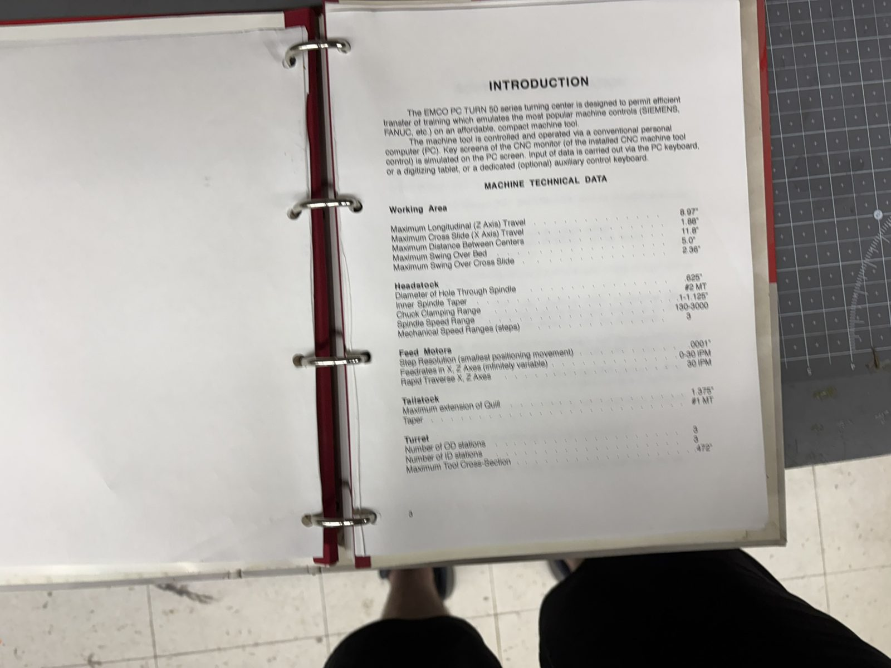
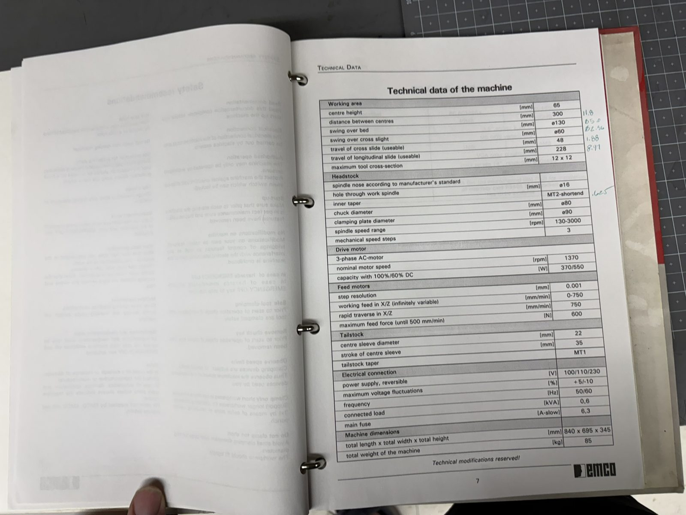

## 4. Spindle

| Item | Value | Source |
| --- | --- | --- |
| Speed range | 130–3000 rpm in **three belt steps: 130–1300 / 200–2000 / 300–3000 rpm**, changed by hand; the fitted belt position must be entered in the control software (speed monitoring + threading sync) | [MANUAL] |
| Motor | ELIN 3-phase, 0.37 kW, 1370 rpm, 220/380 V, frame 71 B14, IP54 | [SCHEM] |
| Power at spindle | 370 W (100 % duty) / 550 W (60 % duty); torque up to ~7 Nm | [MANUAL] |
| Drive | FRC105 frequency inverter card `Y4A400000`, fed 230 V through contactors K1/K2 | [SCHEM] |
| Spindle bore | 16 mm [0.625 in] through hole | [MANUAL] |
| Spindle taper | MT2 (shortened) | [MANUAL] |
| Spindle nose | 3 fixation screws + 4 support threads; chuck ø90 mm | [MANUAL] |
| Encoder | exists — encoder board feeds CPU connector `X109` with +5 V, GND, STROBE, SYNC | [SCHEM] |
| Encoder resolution / channel count | **unknown** — STROBE/SYNC naming suggests a count channel plus index, but nothing in the documentation states it | [UNVERIFIED] |
| Threading | supported (G33, G78), **≤400 rpm only**; alarm 8010 if the sync mark is not found | [MANUAL] |

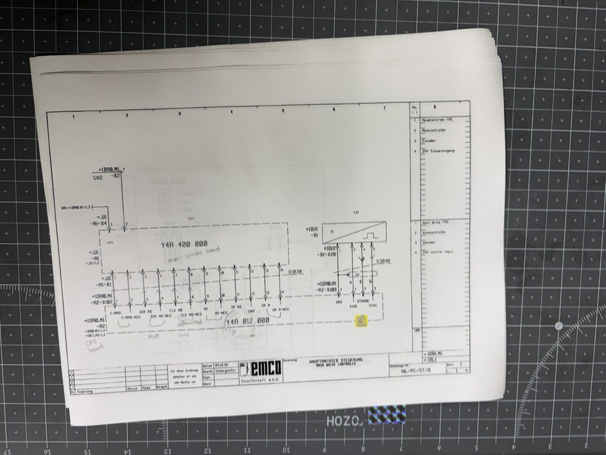

## 5. Axis drives

| Item | Value | Source |
| --- | --- | --- |
| Motors | Berger Lahr **VRDM 564/50 LN**, 5-phase, 0.95 A, pentagon winding, 1000/500 steps/rev (half/full step), order no. 12670015000 | [SCHEM] |
| Power stage | `Y4A018000` stepper board, both axes; DIP switch `S301` sets full/half step and motor current; per-axis SERVO READY LEDs | [PLATE] [SCHEM] |
| Step/direction source | CPU board `X104`, 16-pin ribbon (K1040) — see [`20-control-architecture.md`](20-control-architecture.md) §4 | [SCHEM] |
| Motor connectors | `X301` (X axis), `X501` (Z axis), 6 wires each | [PLATE] [SCHEM] |

**Sourcing note:** 5-phase drives are rare. Known substitutes are the Berger Lahr D450
(obsolete) and Vexta UDX5128NA (discontinued; needs the 10 motor leads rewired into a pentagon).
This is the strongest argument for keeping the original `Y4A018000` power stage in any retrofit
([`60-retrofit-design.md`](60-retrofit-design.md)).

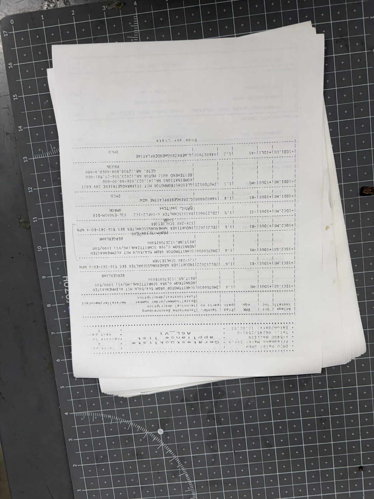

## 6. Homing, limits and safety switches

Read this carefully — it is unusual and it matters at the machine:

- **There are NO end-of-travel limit switches.** Travel ends at mechanical stops; an
  over-travelling stepper simply stalls, audibly ("tack-tack"), and **loses position**. [MANUAL]
- There **are** homing sensors: per axis, one mechanical reference switch (Schmersal ZS 236-11Z /
  ZR231-11Y or Omron V-10FL2-1C2) wired to CPU inputs `X113` (X) / `X117` (Z), plus one
  **Balluff `BES 516-343-E0-X`** NPN inductive "Sync-Bero" proximity switch to `X114` (X) /
  `X118` (Z). [SCHEM]
- **The reference point must be re-approached after every power-off or E-stop** — there is no
  absolute position memory. [MANUAL]
- The only interlock switches are on the **chip guard** and the **(change-)wheel cover**; the
  E-stop chain (E-stop button + those two switches, in series into CPU `X110`/`X111`) drops the
  motor contactors. [MANUAL] [SCHEM]

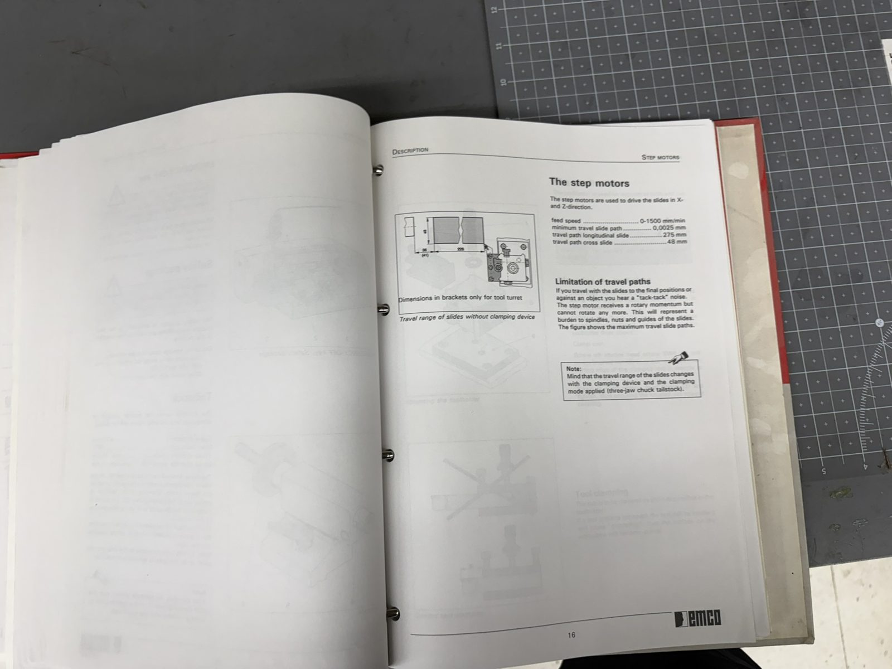
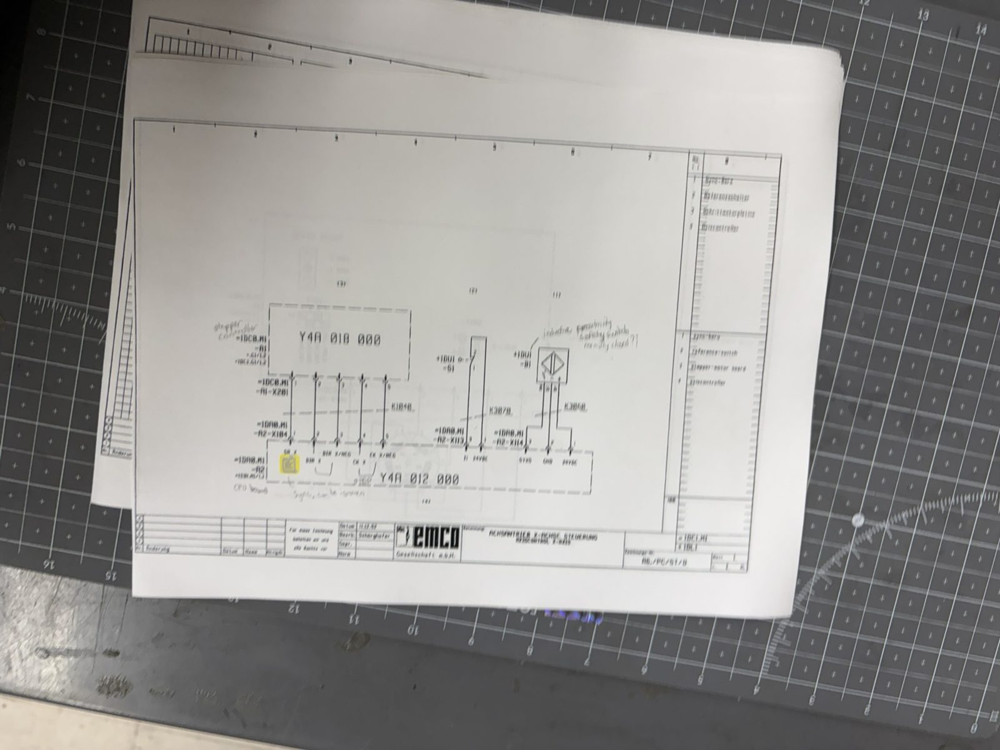

## 7. Turret and tooling

| Item | Value | Source |
| --- | --- | --- |
| Stations | **6: 3 external + 3 internal** (internal take ø10 mm shanks with clamping sleeves). Not 8. | [MANUAL] |
| Max tool section | 12 × 12 mm [0.472 in] | [MANUAL] |
| Max stickout | 12.7 mm [0.50 in] — more and the tool strikes the bed while indexing | [MANUAL] |
| Cutting circle | max 124/140 mm | [MANUAL] |
| Motor | Maxon 24 VDC gearmotor, 60:1 spur gearhead, driven from PLC output `A0.2` ("turret forward") | [SCHEM] |
| Position sensing | turret encoder board `Y4A020000` returning Strobe (`E0.0`) and Sync (`E0.1`) to the PLC | [SCHEM] |
| Fitted? | The turret is a factory **option** requiring the SPS/PLC card, and "cannot be retrofitted". Photographs show a 6-station turret on this machine and an SPS board in the cabinet, but function is unconfirmed. | [MANUAL] / [UNVERIFIED] |
| Alternative | manual quick-change toolpost; tool centre height 30 mm above cross-slide surface, adjustable | [MANUAL] |
| Tool call | `Txxyy` = station xx, offset register yy; 16 offset registers (32 optional) | [MANUAL] |

Recommended stations from the local procedure binder: RH turning tool in station 2, threading in
station 4, parting in station 6. [MANUAL]

## 8. Workholding and tailstock

| Item | Value | Source |
| --- | --- | --- |
| Collets | **ESX 25, 1.5–14 mm**, via collet attachment 200 040 | [MANUAL] |
| 3-jaw chuck | V3U 176, ø90 mm, M5×40 DIN 912 mounting; clamping range 2.5–28.5 mm [0.1–1.125 in] | [MANUAL] |
| 4-jaw chuck | V3U 178 | [MANUAL] |
| Clamping plate | ø90 mm, part 200 420 (4× M5×25) | [MANUAL] |
| Tailstock | sleeve ø22 mm, taper MT1, 35 mm [1.375 in] quill travel, 1 handwheel turn = 1 mm | [MANUAL] |
| Tailstock accessories | drill chuck 1–8 mm (M14×1) with MT1 arbor, centres | [MANUAL] |

## 9. Digital I/O — the "robotic interface"

20–24 V logic, **not potential-free**; outputs short-circuit-proof, 0.2 A max. Terminals live on
the SPS board: `X241` (A0.x outputs), `X213` (E3.x inputs). [MANUAL] [PLATE]

| Output | Function | Input | Function |
| --- | --- | --- | --- |
| A0.0 | program stop (M30/M00/M01) | E3.0 | open door |
| A0.1 | chuck/collet open | E3.1 | close door |
| A0.3 | chuck/collet closed | E3.2 | tailstock backward |
| A0.4 | door open | E3.3 | tailstock forward |
| A0.5 | door closed | E3.4 | open chuck/collet |
| A0.6 | tailstock position | E3.5 | close chuck/collet |
| A0.7 | alarm | E3.7 | feed stop |

(The automated door/chuck/tailstock these signals serve are accessories; whether any are fitted
to this unit is [UNVERIFIED].)

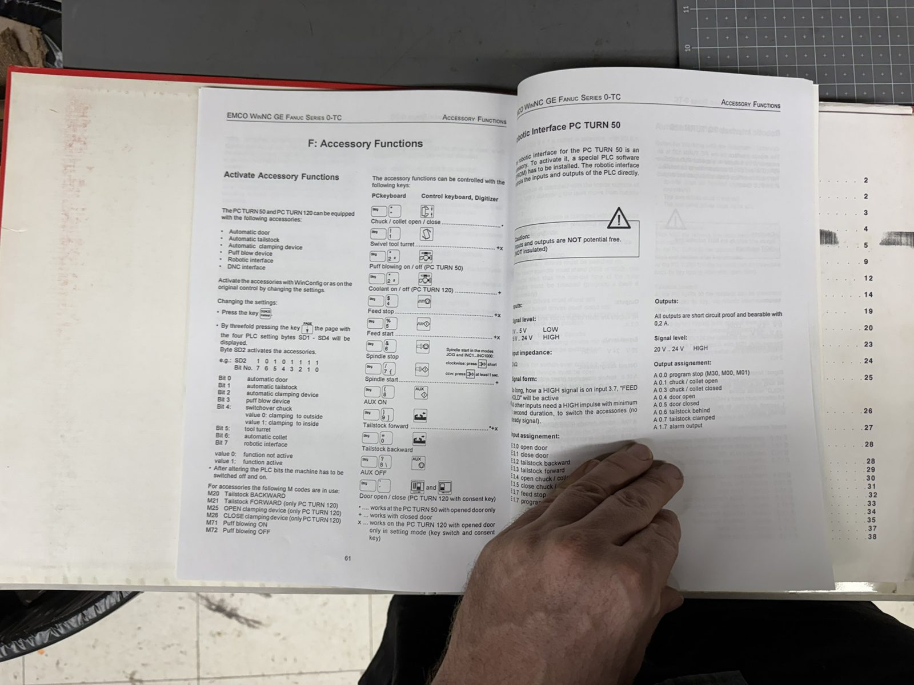

## 10. Board set

The card rack in the red cabinet, from the mounting-panel drawing and photographs. The
community record's "AC95 brain board, `Y4B081000`" **does not exist in this machine**.

| Board | Part | Designator | Role | Source |
| --- | --- | --- | --- | --- |
| Axis controller (CPU) | `Y4A012000` + plug-on `Y4A015000` | =1DA0.M1-A2 | the "brain": motion execution, RS-485 slave | [SCHEM] |
| Stepper power card | `Y4A018000` | =1DC0.M1-A1 | 5-phase power stage, both axes | [PLATE] [SCHEM] |
| PLC ("SPS 2000") | `Y4A011000` + connector board `Y4A016000` | =1DA0.M1-A3 | machine logic, digital I/O, turret | [PLATE] [SCHEM] |
| Spindle inverter | FRC105 = `Y4A400000` | =1DB1.U1-A1 | spindle drive (on-card fuses 4 A FF, 100 mA T) | [SCHEM] |
| DC/DC converter | `Y4A014000` | =1DA0.M1-A5 | +5 V / ±12 V board supplies | [SCHEM] |
| Turret board | `Y4A017000` | =1DD1.U1-A1 | turret motor drive | [SCHEM] |
| Turret encoder board | `Y4A020000` | =1DD1.H1-B1 | turret position (Strobe/Sync) | [SCHEM] |
| PC interface ("PCCOM") | `Y4A013000` | — | 8-bit ISA card **in the DOS PC** (gone), memory-mapped RS-485 master | [MANUAL] [SCHEM] |

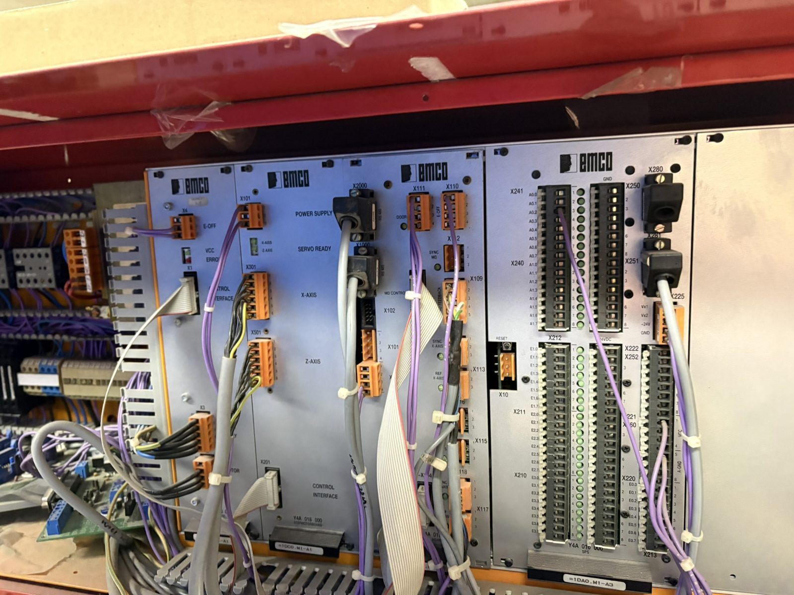
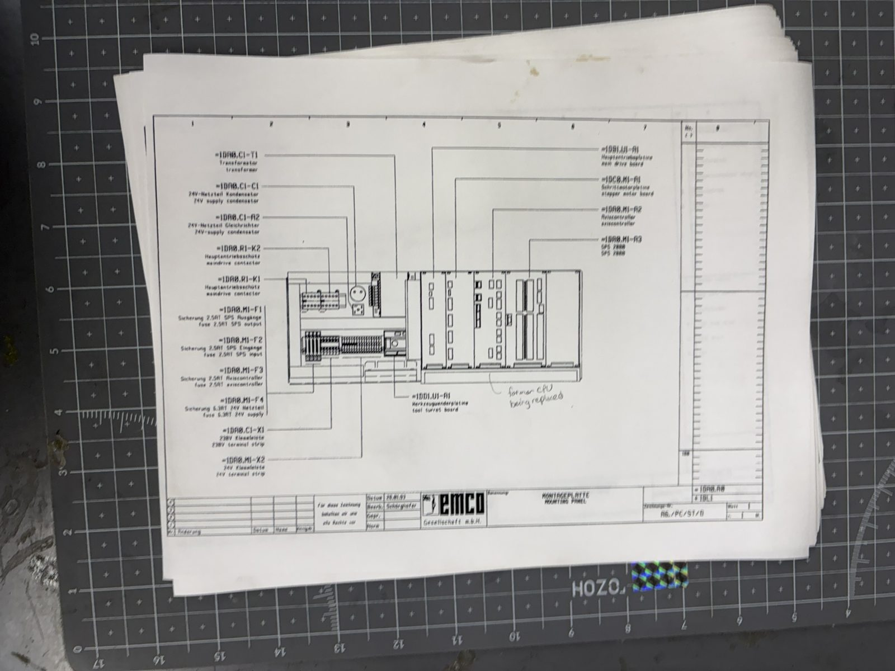

## 11. Alarm codes

This is the list recovered from the photographed alarm pages of the DOS software's manual
(IMG_0792–0794) and supporting pages. The full lists were photographed but some individual texts
were read at low confidence — where an exact wording matters, check the source photo via
[`90-photo-index.md`](90-photo-index.md). All [MANUAL].

### Data transfer and startup (1–510)

| Code | Meaning |
| --- | --- |
| 1 | RS-232 parity error — wrong RS-232 setting in the *external* device (file transfer, not the machine link) |
| 2 | RS-232 transmission error |
| 315 / 325 / 335 | Rotatory checking X/Y/Z — **the step motor fell out of step; approach the reference point** |
| 500 / 501 / 510 | Travel-limit (software limit) alarms |

### RS-485 machine bus (983, 2520-series)

| Code | Meaning |
| --- | --- |
| 983 | RS485 ERROR — initialising PC board |
| 2520 | ORDxx RS485 device absent — machine off, cable unplugged, or **the ISA card is missing** (the alarm this machine will always raise now, if the software were run) |
| 2521 | ORDxx RS485 communication error, per device (AC, SPS, MT, PLC, keyboard, axis controller) |
| 2523 | INIT error on RS485 PC-board |
| 2524 | General failure, RS485 PC-board |
| 2520–2528 | (full RS-485 communications alarm block) |

### Programming (example)

| Code | Meaning |
| --- | --- |
| 2631 | "N xx position already programmed" (simulation/program check error — an example of the 2xxx programming block) |

### Machine / PLC alarms (6000–7053)

| Code | Meaning |
| --- | --- |
| 6000 | EMERGENCY OFF |
| 6010 / 6011 / 6012 | X / Z / axis drive not ready — **stepper board defective or unpowered** |
| 6013 | main drive not ready |
| 6016 / 6017 | clamping-pressure faults |
| 6024 | door (chip guard) not closed |
| 6025 | gearbox (wheel) cover not closed |
| 6032 | main-drive overload |
| 6033 | vacuum-pump overload |
| 6040 | tool-turret failure |
| 6041 | tool-change timeout — turret stuck / collision |
| 6043–6045 | tool-turret sync errors |
| 7000 | wrong tool number |
| 7016 | switch on auxiliary drives (AUX ON) |
| 7017 | approach the reference point |
| 7020–7053 | turret not locked, door, chuck, quill state prompts (individual texts read at low confidence — see IMG_0661) |
| 7040 | door open |

### Spindle synchronisation / threading (8000-series)

| Code | Meaning |
| --- | --- |
| 8010 | Sync error main drive — **synchronising mark not found** (encoder/sync sensor, or belt position not entered) |
| 8020 | thread feed has reached 80 % of maximum feed — reduce rpm or pitch |

### Data I/O (9000-series)

| Code | Meaning |
| --- | --- |
| 9007 | data transmission active |
| 9012 | unknown data type on RS-232 |
| 9013 | error in data received on RS-232 |
| 9018 | invalid RS-232 configuration |
| 9024 | general RS-232 error |
| 9005–9540 | (full data-I/O and digitizer alarm block, photographed) |

### WinNC alarms (different software, same family)

Binder A documents the later Windows software ("WinNC"): startup alarms 0001–0040 (0013 =
serial-interface settings), PCCOM card alarms 8106/8107, and control alarms 8101–8211 including
threading alarms 8194–8197 and 8211. This machine's local procedure binder used the DOS
`FANOT` software, so the DOS list above is the primary one.

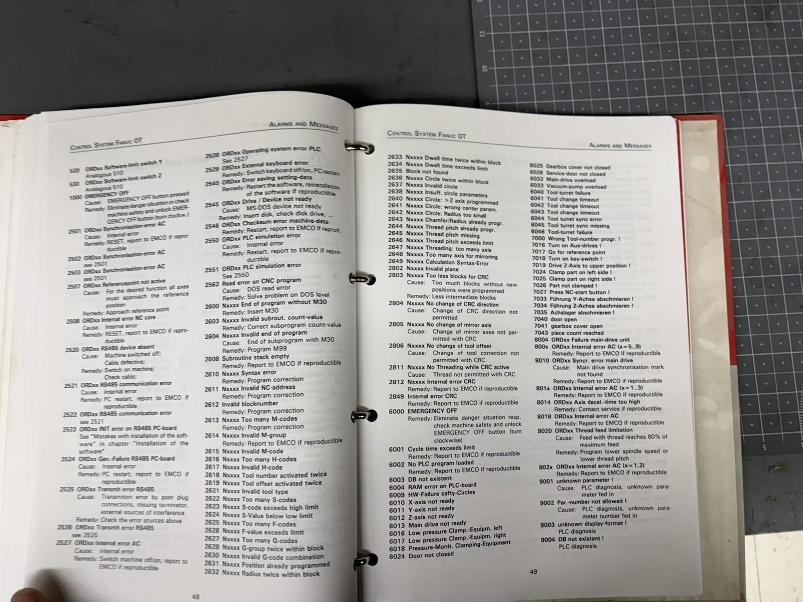

## 12. Spare parts: obtainable vs not

| Part | Status |
| --- | --- |
| EMCO boards (`Y4A012000` CPU, `Y4A011000` SPS, `Y4A018000` stepper, `Y4A400000` FRC105, `Y4A013000` ISA card) | **Unobtainable.** No EMCO support, no aftermarket. A failure of the CPU or ISA card is terminal for the original control scheme — the retrofit ([`60-retrofit-design.md`](60-retrofit-design.md)) is the answer. |
| Berger Lahr VRDM 564/50 LN steppers | Obtainable used (eBay, industrial surplus). 5-phase, 0.95 A — verify winding before buying. |
| Balluff BES 516-343-E0-X inductive sensor | **Still a current Balluff part family** — obtainable new. |
| Schmersal / Omron reference switches | Generic microswitches; obtainable or substitutable. |
| Maxon 24 V gearmotor, 60:1 (combination 41.023.038-00.00-000) | Maxon still makes equivalent RE motor + gearhead combinations; part digits from a blurred print — re-check before ordering. |
| ELIN 0.37 kW 3-phase spindle motor | Standard IEC frame-71 B14 motor; any equivalent fits. |
| ABB BC6-30-01 contactors, Wickmann 2.5 A T fuses, Papst fans, 15000 µF cap | Generic, obtainable. |
| ESX 25 collets | Standard collet system, widely available. |
| V-belts (3-step pulley) | Size not recorded in the photographs — measure the belt [UNVERIFIED]. |

## 13. Open questions — take this list to the machine

1. **Serial number and build year** — the type plate is illegible in every photo. Photograph it
   close-up (plate is below the key switch).
2. Spindle encoder resolution and channel count.
3. Pin-by-pin polarity within each `X104` axis group ([`20-control-architecture.md`](20-control-architecture.md) §4).
4. Whether the optional turret and its SPS card are actually functional on this unit.
5. Turret reverse-lock wiring.
6. Stop-bit count on the COM1/COM2 file-transfer settings page (photo illegible; probably 1).
7. Whether the original DOS software or the `Y4A013000` ISA card survive anywhere with the machine.
8. V-belt size; current belt position (1/2/3).
9. Tailstock variant: manual or electromechanical.
