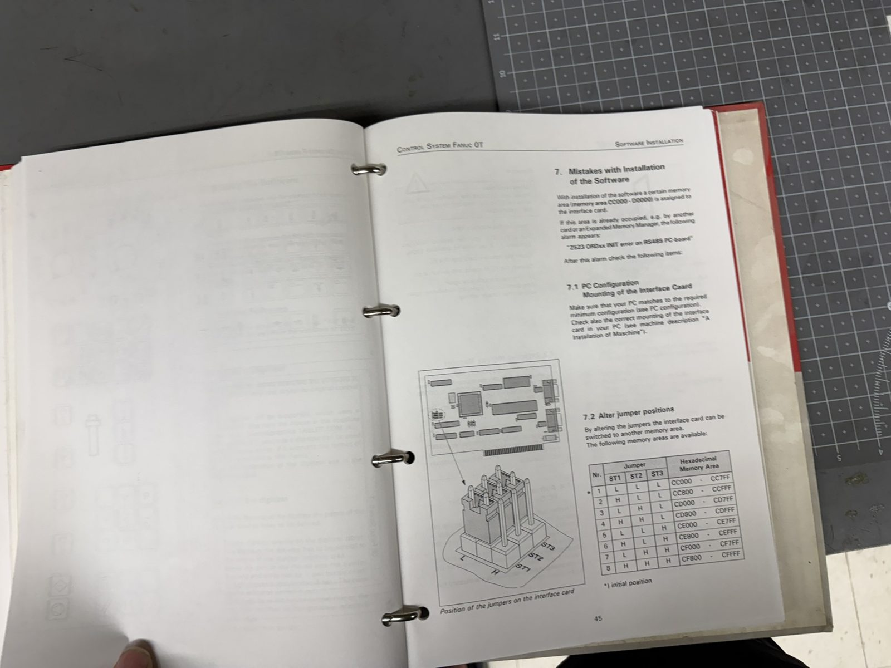
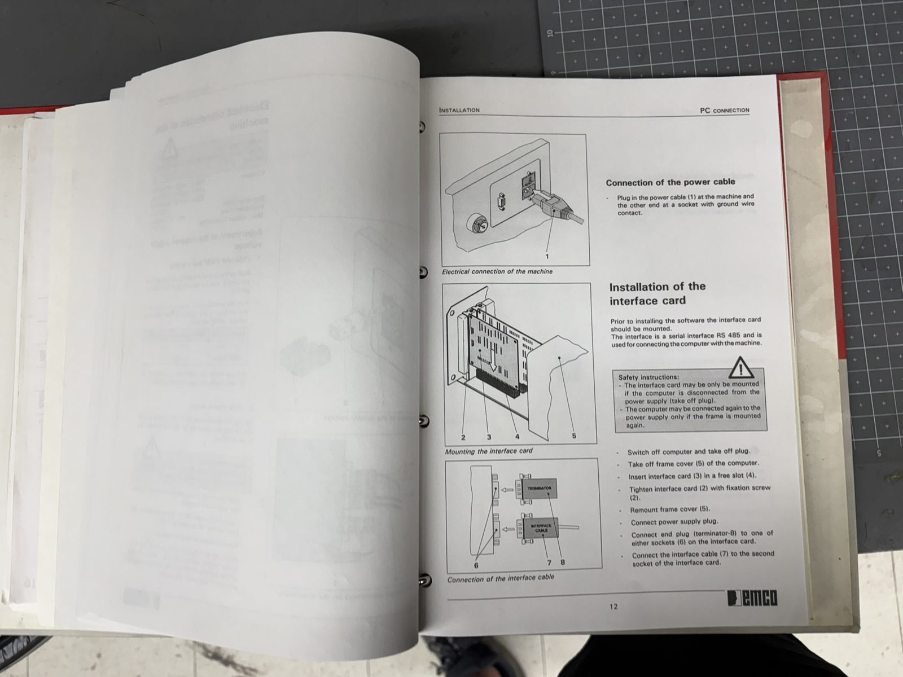
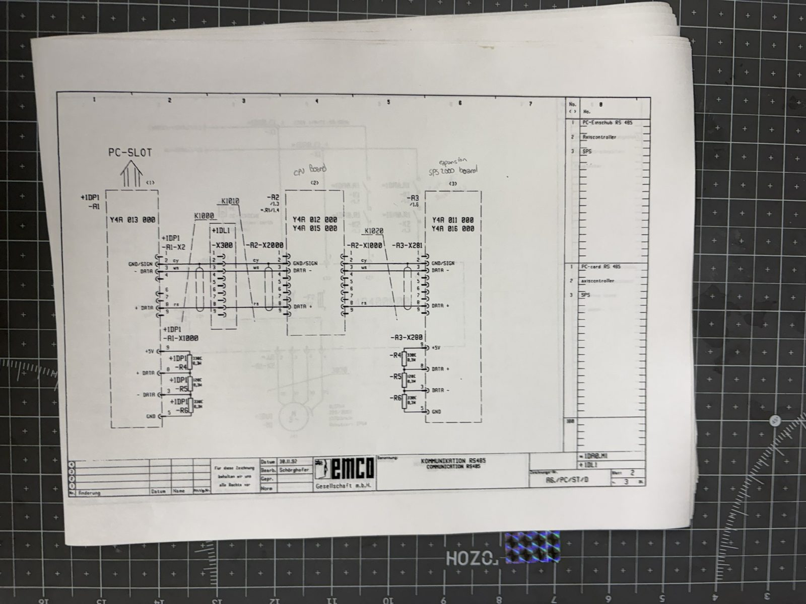
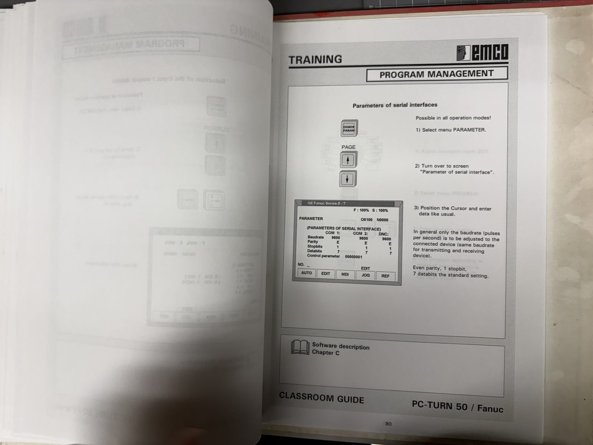
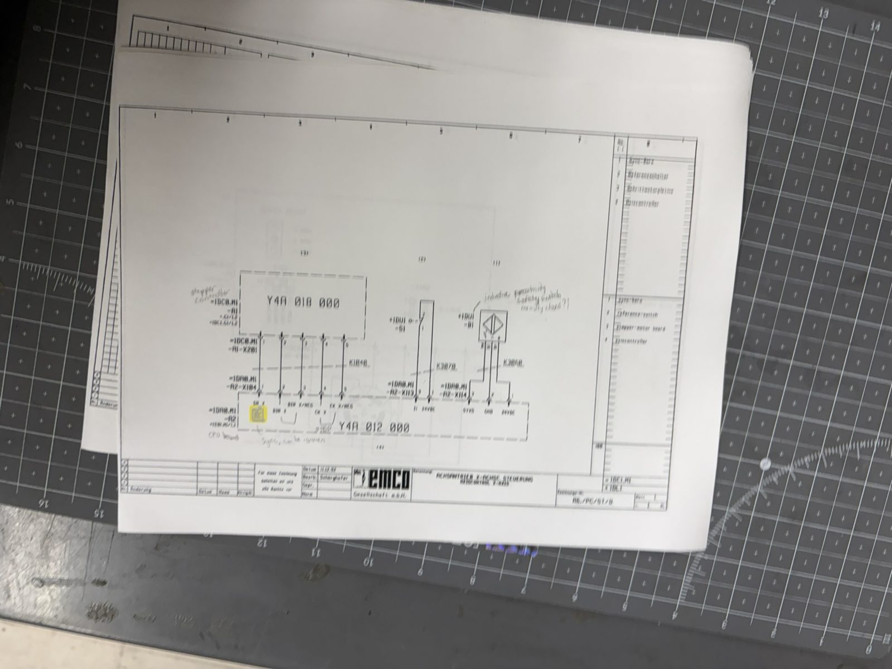
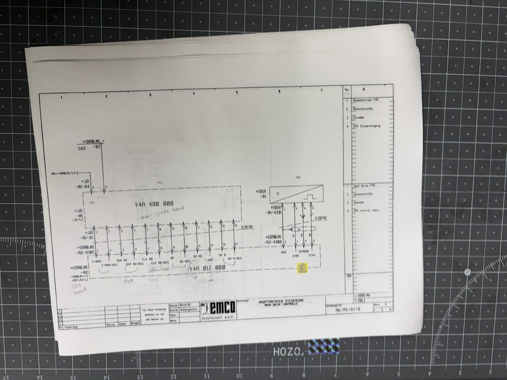
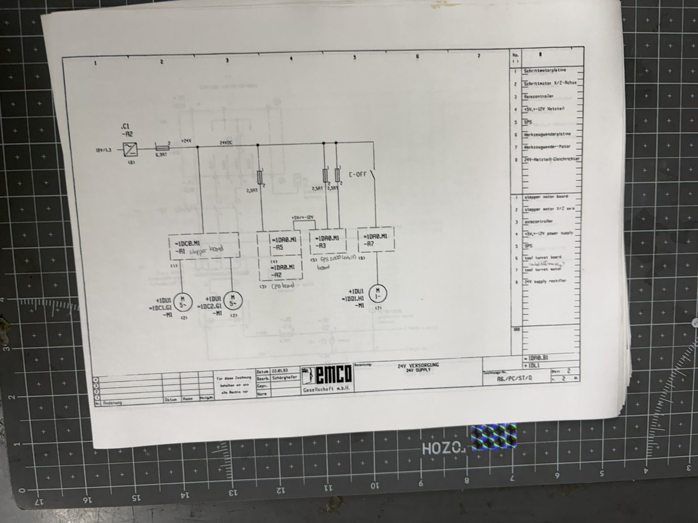
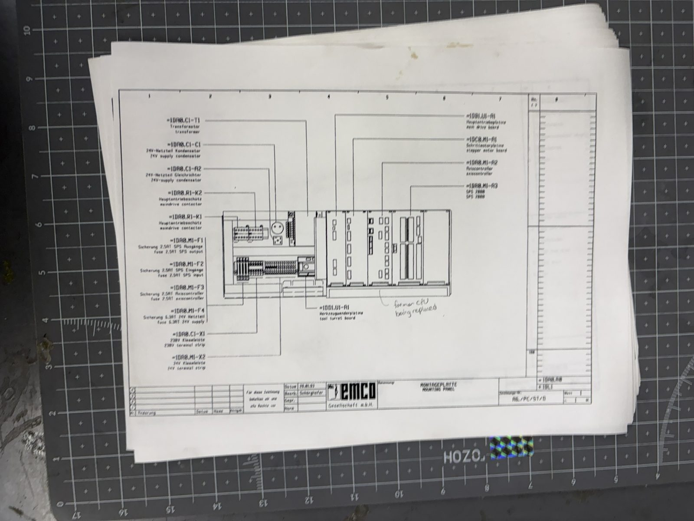

# 20 — Control architecture: what is in the red box, and why LinuxCNC cannot drive it over the DB9

This document explains how the PC TURN 50's control actually works, board by board and signal by
signal, from the machine's own electrical documentation ("VS 4301, Edition 93-5", full schematic
set — photographed, see [`90-photo-index.md`](90-photo-index.md)). It is also the standing
answer to a proposal somebody makes every year: *"can't we just plug LinuxCNC into the serial
port?"* No — and §3 explains why, permanently.

Source tags as in [`10-machine-reference.md`](10-machine-reference.md): [PLATE] / [SCHEM] /
[MANUAL] / [UNVERIFIED].

---

## 1. The big picture

The PC TURN 50 splits the CNC control across two computers:

- **The DOS PC** ran everything a user thinks of as "the control": the Fanuc-0T interpreter,
  canned cycles, screens, program storage (`C:\PCNC`, started with `FANOT`). [MANUAL]
- **The red cabinet** is the executor: an axis-controller CPU that generates step pulses, a PLC
  for machine logic, power stages for steppers, spindle and turret. [SCHEM]

Between them: a proprietary **3-wire half-duplex RS-485 multidrop bus**, mastered by a
memory-mapped ISA card in the PC. [SCHEM] [MANUAL]

```
 DOS PC (gone)                          red control cabinet
┌───────────────────┐                 ┌───────────────────────────────────────────────┐
│ FANOT software    │                 │                                               │
│  interpreter,     │                 │  X300 (DB9) ──K1010── CPU Y4A012000 ──K1020── SPS 2000 PLC
│  planner, UI      │                 │  RS-485 in            (+Y4A015000)            Y4A011000
│        │          │                 │                        │        │             │   │
│        ▼          │    K1000        │              X104 ribbon│        │X107         │   │ A0.x/E3.x
│ ISA card          │  3-wire RS-485  │              (step/dir) │        │(spindle     │   │ robotic I/O
│ Y4A013000         ├────────────────►│                        ▼        ▼ ctl)        │   ▼
│ "PCCOM":          │  pins 2/3/8     │            stepper board      FRC105          │ turret board
│ 4 KB dual-port    │                 │            Y4A018000          Y4A400000       │ Y4A017000
│ RAM at CC000,     │                 │             │      │            │             │   │
│ NOT a UART        │                 │             ▼      ▼            ▼             │   ▼
└───────────────────┘                 │        X motor   Z motor   spindle motor      │ Maxon 24V
                                      │     (Berger Lahr 5-phase)  (ELIN 0.37 kW)     │ gearmotor
                                      └───────────────────────────────────────────────┘
```

## 2. The PC link: RS-485 through a memory-mapped ISA card

### 2.1 The card

The `Y4A013000` "PCCOM" / "FC-Einschub RS 485" is an **8-bit ISA card** that presents a **4 KB
dual-port RAM window** to the PC, default **CC000–CCFFF**, jumper-selectable via ST1–ST3 across
CC000–CFFFF, plus a selectable IRQ (3/4/5/7/10/11/12/15). [MANUAL]

**It is not a UART.** The DOS software reads and writes shared memory; the card's own hardware
serialises that onto the RS-485 wire in a framing nobody has documented. There was never a byte
stream a COM port could reproduce. The card has two 9-pin sockets: one takes a **terminator
plug**, the other the cable to the machine. Without the card, the software raises alarm
**"2520 ORDxx RS485 device absent"**. [MANUAL]




### 2.2 The bus and connector `X300`

Schematic sheet "KOMMUNIKATION RS485" (=1DA0.M1 sheet 2): ISA card → cable K1000 → bulkhead
connector **`X300`, the DB9 on the cabinet rear** → K1010 → CPU board connector `X2000` → K1020
daisy-chain → SPS board `X201`. A multidrop device bus; alarm texts name devices "AC, SPS, MT,
PLC, control keyboard, axis controller", and the optional EMCO control keyboard took a bus
address 0–15. [SCHEM] [MANUAL]

| X300 pin | Signal | Note |
| --- | --- | --- |
| 2 | GND / SIGN (signal ground) | |
| 3 | DATA− | |
| 8 | DATA+ | |
| 5 | GND | at terminated ends (bias return) |
| 9 | +5 V | at terminated ends (bias supply) |
| 1, 4, 6, 7 | not used | per schematic |

Termination/bias at both bus ends: 330 Ω from +5 V to DATA+, 120 Ω across DATA+/DATA−, 330 Ω
from DATA− to GND. [SCHEM]

> **Never plug an RS-232 device into this connector.** RS-232 swings up to ±12 V single-ended;
> this port is low-voltage differential with +5 V exposed on pin 9. RS-485 (A/B) interfaces
> only — and meter first, per [`30-serial-protocol.md`](30-serial-protocol.md) §7.



### 2.3 The RS-232 that *does* exist — and why the folklore is wrong

The 9600/7/E serial settings in the binders belong to the **DOS PC's own COM1/COM2**, used only
to move part-program and tool-offset *files* to external devices (F9 output, F10 input). That
port lived on a computer that no longer exists, and it never carried motion. The community
belief that this machine's DB9 is "RX/TX/CTS/GND RS-232 taking G-code" is refuted by the
machine's own manuals. [MANUAL]



## 3. Why LinuxCNC cannot drive this machine over the DB9

The standing answer. Two independent reasons; either alone is fatal.

1. **The port doesn't speak anything LinuxCNC could learn to say.** The DB9 is a proprietary
   RS-485 device bus whose framing was generated *in hardware* by the ISA card, from dual-port
   RAM. There is no documented protocol, no reference implementation, and no surviving
   transmitter to observe. Even a perfect USB-RS485 adapter gives you the electrical layer of a
   language nobody alive speaks. (Recovering it is the — possibly intractable — subject of
   [`30-serial-protocol.md`](30-serial-protocol.md).)
2. **The box is a CNC control, not an amplifier.** LinuxCNC is a motion controller: it closes a
   servo loop ~1000×/s and emits step pulses itself. The cabinet's CPU board is *also* a motion
   controller, expecting supervisory commands from the EMCO software. LinuxCNC has no mechanism
   for delegating coordinated motion to somebody else's black box over a serial line, and was
   never designed to. Bolting the two together is an architecture mismatch, not a missing driver.

What a LinuxCNC retrofit actually does is **replace the CPU board's role**: unplug the `X104`
ribbon from the EMCO CPU and drive the stepper power card's step/direction inputs directly
(§4), with LinuxCNC's own hardware (e.g. a Mesa card) as the pulse source. That is a real,
reversible design — see [`60-retrofit-design.md`](60-retrofit-design.md). It is the *only* way
LinuxCNC will ever move this machine.

## 4. Board by board

### 4.1 Axis controller (CPU) — `Y4A012000` + `Y4A015000`

The brain of the cabinet (designator =1DA0.M1-A2; the electrical doc calls it
"Axiscontroller"). An RS-485 slave that executes motion: it generates step/direction for both
axes, runs the spindle interface, and monitors the reference sensors and E-stop chain. [SCHEM]

Its connectors, all from the schematics [SCHEM]:

| Connector | Carries |
| --- | --- |
| `X1000` / `X2000` | RS-485 bus in/out (daisy chain) |
| `X104` | 16-pin ribbon: step/direction, both axes → stepper board (§4.2) |
| `X107` | 14-way spindle control → FRC105 (§4.4) |
| `X109` | spindle encoder: +5 V, GND, STROBE, SYNC |
| `X110` / `X111` | E-stop chain (E-stop button, wheel-cover switch, door switch in series) |
| `X113` / `X114` | X reference switch / X Sync-Bero |
| `X117` / `X118` | Z reference switch / Z Sync-Bero |
| `X9` | +5 V / ±12 V from the DC/DC board |

### 4.2 The `X104` step/direction path — where a retrofit taps in

Ribbon K1040, 16-pin IDC, CPU `X104` → stepper board `X201`. Pin assignment from the axis
control schematics (=1DC1.M1 / =1DC2.M1): [SCHEM]

| Pin | Signal | Pin | Signal |
| --- | --- | --- | --- |
| 1 | SR X (servo ready) | 6 | SR Z (servo ready) |
| 2 | DIR X | 7 | DIR Z |
| 3 | DIR X− | 8 | DIR Z− |
| 4 | CK X (step clock) | 9 | CK Z (step clock) |
| 5 | CK X− | 10 | CK Z− |
| 16 | E-Achse (axis enable) | | |

`DIR` and `CK` are **differential pairs** — a retrofit feeding this header must drive them
differentially, not single-ended. The pin order within each group was read from a slightly
blurred sheet and cross-checked against the sharper Z sheet; **meter it on this unit before
connecting anything** [UNVERIFIED — polarity/order confirmation pending].



### 4.3 Stepper power board — `Y4A018000`

5-phase power stage for both axes (=1DC0.M1-A1, "Schrittmotorplatine"). [SCHEM] [PLATE]

- Motors: Berger Lahr VRDM 564/50 LN, 5-phase pentagon winding, 0.95 A, 1000/500 steps/rev
  (half/full). [SCHEM]
- DIP switch `S301`: full/half step plus three current-set switches; jumper field `X202`
  ("R-LAUF"). [SCHEM]
- Connectors (silkscreen): `X301` X-AXIS, `X501` Z-AXIS (6 wires each), `X1`/`X201` CONTROL
  INTERFACE, `X4` E-OFF; VCC/ERROR and per-axis SERVO READY LEDs. [PLATE]

This board is irreplaceable-by-purchase and drives motors whose modern drives are unobtainium —
which is why the retrofit design keeps it.

### 4.4 Spindle: FRC105 inverter — `Y4A400000`

Frequency inverter (=1DB1.U1-A1) fed 230 V through contactors K1/K2, driving the ELIN 0.37 kW
3-phase motor. On-card fuses 4 A FF and 100 mA T. [SCHEM]

Control interface FRC `X1` ↔ CPU `X107`, 14-way, differential: enable (`E/AMD±`), direction
(`DIR MD±`), speed clock (`CLK MD±`), zero pulse (`NI±`), current/analog (`IA MD`), servo ready
(`SR M±`). Signal names read at moderate confidence from a blurred sheet. [SCHEM]

A **spindle encoder exists**: pickup −B1 on the spindle, cable K3040 → CPU `X109`
(+5 V, GND, STROBE, SYNC). Resolution and channel count are nowhere stated
[UNVERIFIED]. Threading worked under the original control at ≤400 rpm, with the belt position
entered in software for sync (alarm 8010 if the mark is not found). [MANUAL] [SCHEM]



### 4.5 PLC — "SPS 2000", `Y4A011000` + `Y4A016000`

Machine logic and digital I/O (=1DA0.M1-A3). An RS-485 bus device in its own right. Terminals:
`X241` outputs A0.0–A0.7, `X240` A1.x, `X220` inputs E0.x, `X210–X213` E1.x–E3.x, `X225`
24 V supply. The A0.x/E3.x "robotic interface" map is in
[`10-machine-reference.md`](10-machine-reference.md) §9. [PLATE] [SCHEM]

The PLC also runs the turret: output `A0.2` drives the Maxon gearmotor forward; the turret
encoder board `Y4A020000` returns Strobe (`E0.0`) and Sync (`E0.1`). Classic EMCO ratchet
mechanism — rotate forward counting stations, reverse against a pawl to lock (reverse wiring
not shown on the photographed sheet [UNVERIFIED]). [SCHEM]

### 4.6 DC/DC converter — `Y4A014000`

=1DA0.M1-A5 ("G.NETZTEIL RS 485"): makes +5 V and ±12 V for the boards from the 24 V rail,
distributed over the −A5-X1 → CPU X9 → SPS X11 ribbon. [SCHEM]

### 4.7 Power section

Mains → fused IEC inlet (6.3 A T) → key switch → 600 VA transformer (taps 100/120/220/240 V;
in US service it steps 110 V up to the 230 V bus for the spindle inverter and fans). Secondary
18 V 7 A → bridge rectifier → 15000 µF → 24 VDC bus (fuse F4 6.3 A T) feeding stepper board,
CPU, SPS, E-stop chain and turret motor. Board fuses F1–F3, 2.5 A T. [SCHEM]




### 4.8 E-stop chain

Hardware, not software: E-stop button (Telemecanique ZA2 BS54), wheel-cover switch and
chip-guard door switch in series, into CPU `X110`/`X111` and relays K1/K2 that drop the
main-drive contactors. This chain is the machine's only real stop; anything sent over a cable is
advisory. [SCHEM]

## 5. Cable map

For tracing at the machine. All [SCHEM].

| Cable | From → To |
| --- | --- |
| K1000 | PC ISA card → cabinet DB9 `X300` (RS-485) |
| K1010 / K1020 | `X300` → CPU `X2000`; CPU `X1000` → SPS `X201` (RS-485 daisy chain) |
| K1030 | CPU `X107` → FRC105 `X1` (spindle control, 14-way) |
| K1040 | CPU `X104` → stepper board `X201` (step/dir ribbon, 16-way) |
| K3040 | spindle encoder → CPU `X109` |
| K3050 / K3080 | stepper board → X / Z motors (6-way) |
| K3060 / K3090 | X / Z Sync-Bero → CPU `X114` / `X118` |
| K3070 / K3100 | X / Z reference switch → CPU `X113` / `X117` |
| K3000–K3020 | E-stop chain |

## 6. Where a retrofit taps in

Summary; the full design is [`60-retrofit-design.md`](60-retrofit-design.md).

- **Axes:** unplug ribbon K1040 from CPU `X104`; drive the stepper board's `X201` from a modern
  motion card through a differential line driver. Keeps the unobtainable 5-phase power stage and
  motors untouched and makes the change reversible.
- **Spindle:** inject enable/direction/speed at FRC `X1` if its interface proves drivable
  [UNVERIFIED], else VFD + the existing (standard IEC) motor.
- **Spindle encoder:** the existing STROBE/SYNC pickup may suffice for threading; characterise
  it first [UNVERIFIED].
- **Turret:** drive the Maxon motor and read Strobe/Sync directly, replacing the PLC's sequence
  with ClassicLadder or similar.
- **Safety:** keep the hardware E-stop chain exactly as it is, and treat adding true
  end-of-travel limit switches as a genuine improvement — the original machine has none.
