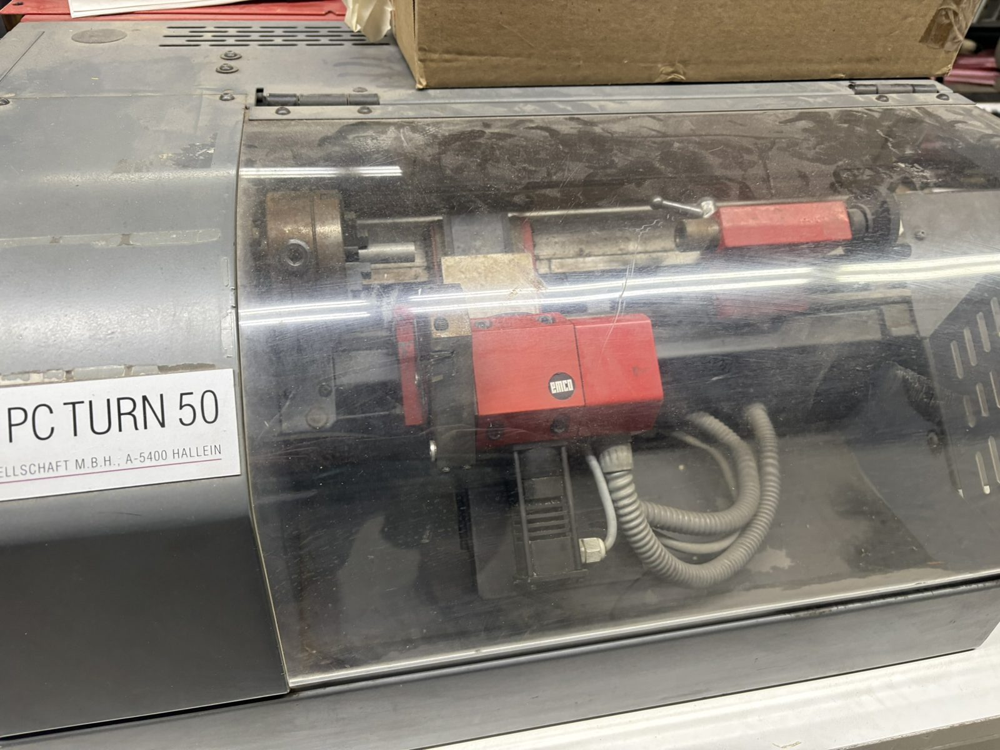

# 40 — Operator guide: from arriving at the machine to holding a part

Written for a MakeICT member who has **never run a CNC lathe**. Follow the numbered steps
literally; where a judgement call exists, the safe choice is written down. Terms are explained
the first time they appear.

> ## Read this before anything else: the machine cannot cut today
>
> The PC TURN 50 was driven by a DOS PC that no longer exists, over a link nobody can currently
> speak ([`20-control-architecture.md`](20-control-architecture.md)). **There is presently no
> way to command this lathe to move.** Every step below that needs the control is marked
> **[CONTROL — simulator only]**: do it in the LinuxCNC training simulator
> ([`70-simulator.md`](70-simulator.md)) instead. The mechanical steps (workholding, belts,
> inspection) are real today and worth learning at the machine — with the power off.
>
> This guide is written so that when a control path exists (protocol recovery or retrofit), the
> procedure is already correct. The keystrokes of the original DOS software are preserved in
> small "*historical*" notes for the record.

---

## 1. Safety — meant seriously

This is a machine tool with a **powered chuck**. It is small, but it spins at up to 3000 rpm and
it can take a finger off, grab a sleeve, or throw a part at your face.

1. **Eye protection always** when the machine has power. No exceptions, and none for bystanders
   inside arm's reach either.
2. **No gloves, no loose sleeves, no dangling jewellery, hair tied back.** Rotating machinery
   plus anything that can wrap equals amputation. Gloves are for handling stock, never near a
   turning spindle.
3. **The chuck key never stays in the chuck.** Hand on the key = key in the chuck. Let go, key
   comes out. A key left in becomes a projectile at power-on.
4. **Know your stop before you need it.** The real stops are the **EMERGENCY-OFF** and the
   **key switch on the red cabinet** — they physically drop the motor contactors. Anything
   software offers (a stop button in a UI, a command over a cable) is advisory only. Physically
   touch the E-stop and the keyswitch before your first session, so your hand knows the way.
5. **This machine has NO end-of-travel limit switches.** [MANUAL] If the carriage is driven to
   the end of travel it hits a mechanical stop and the motor stalls with a loud "tack-tack" —
   and the control **loses track of position** from that moment. It will not damage itself, but
   everything it does next is at the wrong coordinates until you re-reference (§5). Treat any
   stall as a mandatory stop-and-re-reference.
6. **Guards closed.** The chip guard and the wheel (belt) cover carry interlock switches wired
   into the E-stop chain [SCHEM] — they are there for your eyes and fingers. Never defeat them.
7. **Never run the machine unattended, and never remotely.** Someone stands at the machine,
   within reach of the stop, whenever the spindle can turn.
8. **Get checked out first.** MakeICT shop rules apply: a member who knows the machine signs you
   off before you run it alone.
9. Threading, parting and interrupted cuts are the operations most likely to grab. Slow down,
   and keep your hand off the work area.

## 2. Know the machine (5 minutes, power off)

Walk around it and identify: the **spindle and chuck** (left), the **cross slide (X)** moving
toward/away from you, the **carriage (Z)** moving along the bed, the **6-station turret** (if
you have tooling questions, [`10-machine-reference.md`](10-machine-reference.md) §7), the
**tailstock** (right, MT1 taper, 35 mm quill), the **chip guard**, and the separate **red
control cabinet** with its key switch, E-stop and the DB9 connector nobody may plug RS-232
into.

Coordinates, which you must internalise before touching G-code:

- **X** is the cross slide. X0 is the spindle **centreline**; positive X retracts away from it.
  Programs state X as a **diameter** by convention (see [`50-gcode-reference.md`](50-gcode-reference.md)).
- **Z** runs along the bed. Z0 (work zero) is usually the **face of your stock**; cutting
  happens at negative Z, toward the chuck.

## 3. Pre-start checks (every session)

1. Chip guard glass clean enough to see through; guard closes and latches.
2. Bed and slideways free of chips and grit; wipe and oil if dry (see
   [`80-maintenance.md`](80-maintenance.md)).
3. Chuck or collet: correct for the job, clean, undamaged. Chuck key accounted for, out of the
   chuck.
4. Turret tools: tight, sharp, correct stickout — **max 12.7 mm [0.50 in]**, or a tool strikes
   the bed when the turret indexes. [MANUAL]
5. Tailstock clear of the working area unless the job uses it.
6. Belt cover closed; note which belt position is fitted (§6) — you will need to tell the
   control.
7. Nothing on the machine that isn't part of the job: no tools, rags or coffee on the bed or
   headstock.
8. You know where the E-stop is. Touch it.

## 4. Power-on

1. Ensure the working area is clear and the chuck is empty or holds only your intended stock.
2. Turn the **key switch** on the red cabinet. Fans should be audible. [SCHEM]
3. **[CONTROL — simulator only]** Start the control. *Historical: the machine had to be powered
   on before the DOS PC booted, or the software raised alarm 2520 "RS485 device absent"; the
   operator then ran `CD\PCNC` and `FANOT`.* In the simulator: `docker compose -f
   sim/compose.yml up`, browser to `http://localhost:8080`, take the control out of E-stop and
   switch the machine on (F1, F2). The screen then asks which belt is fitted (§6).

## 5. Reference the machine — every single power-on, no exceptions

**This is the step people skip, and it is the one that wrecks parts and crashes tools.**

The machine has stepper motors and **no absolute position memory**. At power-on it has no idea
where the carriage is. Until you send it to its reference point — fixed sensors at the retracted
end of each axis [SCHEM] — every coordinate it displays is fiction.

- **Reference after every power-off.** Also after every E-stop, and after any stall ("tack-tack"
  noise — §1.5), because a stalled stepper has silently lost count. [MANUAL]
- Referencing moves the carriage at rapid speed to the far corner. Make sure the tailstock and
  anything in the chuck are clear of that path first.

**[CONTROL — simulator only]** In the simulator: press **Home All**. The simulator's screen
refuses to run, jog, start the spindle or accept MDI until you have, and it throws the reference
away again at every E-stop, exactly as the real machine does. The soft limits that then protect you in the simulator **do not exist on
the real machine** — do not let them teach false confidence. *Historical: F1 → F7 (REF), then
keypad 5 to execute; the machine rapids to the reference point; machine zero is the spindle
centreline at the spindle front face.*

## 6. Spindle speed range — the belt

The spindle has three speed ranges selected by moving a V-belt by hand, **with the machine
powered off**: [MANUAL]

| Belt position | Speed range |
| --- | --- |
| 1 | 130–1300 rpm |
| 2 | 200–2000 rpm |
| 3 | 300–3000 rpm |

Position 2 covers most work on this machine. Small diameters and finishing want higher speed;
threading must stay **at or below 400 rpm** regardless of range. [MANUAL]

1. Power off at the key switch.
2. Open the wheel cover (its interlock switch prevents running with it open).
3. Move the belt to the wanted pulley step; check tension and alignment by eye.
4. Close the cover.
5. **Tell the control which position is fitted** — the control uses it for speed monitoring and
   for synchronising threading; a wrong entry causes wrong speeds and alarm 8010 during
   threading. [MANUAL] **[CONTROL]** (The simulator does not model belt ranges; just respect the
   130–3000 rpm envelope.)

Belt-change mechanics are covered in more detail in [`80-maintenance.md`](80-maintenance.md) §4.

## 7. Workholding

### ESX 25 collets (preferred for round stock 1.5–14 mm)

Collets grip concentrically and can't fling a chuck key. Each collet fits only a narrow diameter
range — use the size marked for your stock. [MANUAL]

1. Clean the collet, the collet seat and the stock. A chip inside a collet ruins concentricity.
2. Fit the collet into the collet attachment, insert the stock, and tighten the nut firmly by
   hand with the proper wrench.
3. **Stickout:** as short as the job allows. Unsupported stock longer than ~3× diameter chatters;
   longer than ~5× needs tailstock support. For the tutorial part, ~30 mm proud is right.
4. Tug the stock. If it turns by hand force, it will turn under a cutting load.

### 3-jaw chuck (irregular or larger stock, 2.5–28.5 mm clamping range)

1. Seat the stock against the jaw steps, centred; tighten with the key.
2. Spin the chuck by hand one full turn — checking nothing hits the tool, turret or guard.
3. **Remove the key.** Now, not later.

## 8. Tooling and the turret

The turret has **6 stations: 3 for external tools (12 mm shank max) and 3 for internal tools
(ø10 mm boring bars in sleeves)**. [MANUAL] Suggested layout, matching the local procedure
binder and the simulator tool table (`linuxcnc/sim/emco-pcturn50/emco-pcturn50.tbl`):

| Station | Tool |
| --- | --- |
| T1 / station 2 | right-hand turning/facing tool |
| station 4 | threading tool |
| T3 / station 6 | parting blade |

Rules that keep the turret out of the chuck:

- Max stickout 12.7 mm [0.50 in]. [MANUAL]
- **Retract fully in X before any tool change** — the turret sweeps a wide circle when
  indexing. The example programs all open with `G53 G0 X96` (they run in diameter mode, G7,
  where the full 48 mm radius retract is written X96); copy that habit.
- Spindle stopped before indexing.

**[CONTROL — simulator only]** Tool change is `T_ M6` (simulator) — the turret indexes and the
tool's offsets apply. *Historical: CONTROL+1 (or Ctrl+I in JOG) indexed the turret one station;
in MDI, `T0404` meant station 4 with offset register 4.*

## 9. Offsets: telling the control where your part and tools are

Two layers, and the distinction matters:

- **Work offset (work shift / G54):** where your *part* is. Z0 at the face of the stock, X0 on
  the centreline (X never shifts on a lathe — the centreline is the centreline).
- **Tool offsets:** how much longer/shorter each *tool* is than the reference. Set once per
  tool, they persist; the work offset changes with every new stock length.

This procedure is modernised from the shop's own binder ("work shift offset", steps 11–28) and
EMCO's start-up guide. **[CONTROL — simulator only]** throughout; practise it there until it is
boring, because on a real machine an error here is a crash.

### 9.1 Set the work offset (Z)

1. Reference the machine (§5). Chuck your stock (§7).
2. Select a turning tool (T1) and start the spindle at a moderate speed for the material —
   e.g. `M3 S800` for small aluminium.
3. **Face the end**: jog the tool carefully to just touch the rotating face, then take a light
   facing cut so the face is clean and square.
4. **Do not move Z.** The tool tip is now exactly at your part's Z0.
5. Set the work offset here: in the simulator, the **Touch-off** tab walks this section step by
   step and sets G54 Z0 for you (`G10 L20 P1 Z0`).
   *Historical: OFFSET → W.SHIFT, enter the measured distance as a negative Z work shift; the
   binder's alternative was dragging a strip of paper between tool and face to feel the touch.*
6. Retract in X (`G53 G0 X96` in diameter mode, `X48` in radius mode), stop the spindle, and verify: commanding `G0 Z5` should put the
   tool 5 mm to the right of the fresh face. If it doesn't, stop and redo — do not "adjust as
   you go".

### 9.2 Set a tool's offsets (per tool, X then Z)

1. With the master tool's work offset set (§9.1), select the tool to measure.
2. **X offset by cutting:** take a light skim cut along the diameter, retract in **Z only**
   (do not move X), stop the spindle, and measure the resulting diameter with a micrometer or
   calliper. Enter that measured value as the tool's X touch-off (in diameter mode the control
   does the ÷2 for you — see [`50-gcode-reference.md`](50-gcode-reference.md)).
   *Historical: the binder computed (measured − stock)/2 by hand into the geometry register.*
3. **Z offset by touching:** touch the tool tip to the freshly faced end (paper-drag or a light
   scratch), and touch off Z = 0 for that tool.
4. Record nose radius and tip orientation if you will use cutter compensation (G41/G42) —
   *historical registers: R and T (types 1–9)* — otherwise leave compensation off (G40).
5. Repeat for each tool in the job. Verify each: `G0 X20 Z5` with a 20 mm bar in the chuck must
   put the tool visibly at 20 mm diameter, 5 mm off the face — a sanity check that costs
   seconds and catches decade errors.

## 10. Load and prove the program

**Never run a program on metal that you have not proven.** The proving ladder, cheapest first:

1. **Simulator, always** — even for programs you wrote yourself, even for the second run after
   "one small edit". `docker compose -f sim/compose.yml up`, open the program, home, and run it
   watching the backplot. The example programs in `gcode/` (start with
   `gcode/tutorial-part.ngc`) are the template: note how each begins with `G53 G0 X96` so it can
   never open by ploughing into the part. The simulator's screen checks a newly opened program
   for the mistakes this guide warns about, and makes its first run single block at reduced
   feed; any edit makes it do so again.
2. Read the program header. Good programs state their stock, tools and work-zero assumption;
   confirm your setup matches, line by line.
3. **[CONTROL]** Dry run / single block at the machine: first pass with **no stock**, in single
   block mode (one line per press), feed override low, hand near the stop.
   *Historical: DRY RUN and single-block (`*` key) existed in the DOS software; feed override
   ran 0–120 %.*
4. Only then, stock in, full run.

## 11. Run it

**[CONTROL — simulator only]** until further notice.

1. Guards closed. Eyes on. Hand free to reach the stop.
2. Start the program. **Watch the first approach move like a hawk** — nearly all crashes happen
   in the first rapid. If the tool is heading anywhere unexpected: stop.
3. Stay at the machine for the whole run. Listen — chatter, squeal or a change in chip colour
   means feed/speed trouble; pause and think.
4. Parting off (the last operation of the tutorial part): slowest feed, and never catch the
   falling part with your hand near the spindle.

## 12. Shutdown

1. Retract the carriage (`G53 G0 X96 Z0` in diameter mode — the example programs end there
   already), spindle off.
2. Remove the part and stock remnant; chuck key out.
3. Brush chips off the ways and into the tray — **never** compressed air (drives chips into the
   slideways) and never bare hands (chips are razor wire).
4. Light oil film on the exposed ways if the machine will sit ([`80-maintenance.md`](80-maintenance.md)).
5. Key switch off, key stored per shop rules.
6. Log any oddity — noise, stall, alarm — in the shop's machine log. The alarm-code table in
   [`10-machine-reference.md`](10-machine-reference.md) §11 says what the numbers mean.

## 13. Where to go next

- G-code, this control's dialect and its traps: [`50-gcode-reference.md`](50-gcode-reference.md)
- The simulator in depth: [`70-simulator.md`](70-simulator.md)
- Why the machine can't cut today, and what would fix it:
  [`30-serial-protocol.md`](30-serial-protocol.md), [`60-retrofit-design.md`](60-retrofit-design.md)
