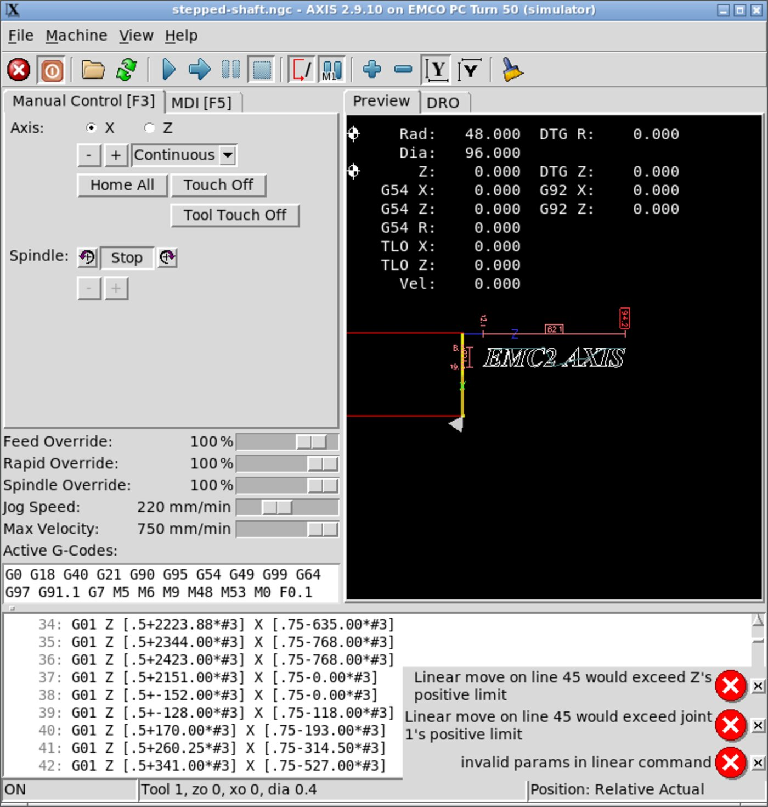

# The simulator

There are two simulators in this repository, and neither one controls the lathe.

| | What it is | Use it to |
| --- | --- | --- |
| **LinuxCNC simulator** (`linuxcnc/sim/`, `sim/`) | A full LinuxCNC running a model of this machine, in a container, in your browser | Learn CNC turning, write and prove programs, practise the referencing and touch-off routine |
| **Sender's simulated machine** (`sender/`) | The browser sender talking to a virtual control instead of a real one | Learn the sender itself, and develop it without hardware |

Start with the LinuxCNC one.



## Why a simulator rather than the machine

Because the machine cannot currently be driven at all. Its control box speaks
**RS-485 through a proprietary memory-mapped ISA card**, that card and its DOS host are
gone, and the protocol is undocumented — see [`20-control-architecture.md`](20-control-architecture.md)
and [`30-serial-protocol.md`](30-serial-protocol.md).

**LinuxCNC cannot be wired to the machine's DB9 to fix this.** That connector is a
differential RS-485 bus, not a serial port, and the box behind it is already a complete CNC
control. LinuxCNC is a motion controller; it has no way to hand coordinated motion to
somebody else's black box. If the machine is ever to run under LinuxCNC it will be through
the retrofit in [`60-retrofit-design.md`](60-retrofit-design.md), which taps the step and
direction signals at connector `X104` inside the box.

So treat this simulator as what it is: a very good way to learn the machine, and the place
to prove a program before anyone runs it for real.

## Running it

```sh
docker compose -f sim/compose.yml up
```

Then open **<http://localhost:8080/vnc.html?autoconnect=1&resize=scale>**.

Stop it with `Ctrl-C`, or `docker compose -f sim/compose.yml down`.

The whole repository is mounted into the container at `/repo`, so editing the config or the
programs in `gcode/` on your own machine takes effect the next time you start it. No rebuild
needed.

### Your first simulated part

1. **Take it out of E-stop** — the first toolbar button, or `F1`.
2. **Turn the machine on** — the second button, or `F2`.
3. **Reference both axes** — `Home All`. Watch where they go: X drives out to 48 mm and Z to
   0. That is the reference corner, and it is where the real machine's reference sensors are.
   **On the real lathe you must do this after every single power-on**, because it has no
   memory of where it is. Build the habit here, where forgetting is free.
4. **Open `tutorial-part.ngc`** — it is loaded by default. Read the comments; the program is
   written as a lesson.
5. **Run it**, and watch the backplot draw the profile.
6. Then try `stepped-shaft.ngc`, which shows subroutines and order of operations.

The full operating routine, including workholding and touch-off, is in
[`40-operator-guide.md`](40-operator-guide.md).

### Checking it still works

```sh
docker compose -f sim/compose.yml down
docker compose -f sim/compose.yml up -d
docker exec emco-pcturn50-sim python3 /repo/sim/acceptance-test.py
```

That takes the machine out of E-stop, references both axes, indexes the turret through an
`M6`, and runs both example programs, failing on any interpreter error. It expects a freshly
started container, because it starts from an un-referenced machine.

## What the simulator does and does not represent

**Modelled from EMCO's manuals** (see [`10-machine-reference.md`](10-machine-reference.md)):
X travel 0–48 mm as a **radius**, Z travel 0 down to −228 mm with machine zero at the
reference corner, 750 mm/min rapid, spindle 130–3000 rpm, a **6-station turret** with an
indexing delay, and referencing that ends at X48 Z0.

**Not represented, and worth knowing:**

- **Soft limits are a lie the simulator tells you.** The real machine has **no
  end-of-travel limit switches**. Travel simply ends at mechanical stops, the stepper stalls
  audibly — the manual calls it "tack-tack" — and the control keeps counting steps it never
  made, so the machine's idea of where it is quietly becomes wrong. LinuxCNC will politely
  refuse the move instead. Do not let that teach you false confidence.
- **Cutting forces, tool deflection, chatter, swarf and coolant.** A program that looks
  perfect here can still be a bad idea in metal.
- **Belt changes.** The spindle's three speed ranges (130–1300 / 200–2000 / 300–3000 rpm)
  are selected by physically moving a belt. The simulator just accepts any speed in range.
- **Backlash.** Not modelled.
- The `M6` turret index is a fixed **1.5 s** delay. Nobody has timed the real turret, and the
  real one only rotates one way, so a long index takes longer than a short one.

## Correcting the numbers

Everything machine-specific is at the top of
`linuxcnc/sim/emco-pcturn50/emco-pcturn50.ini`, in one commented block, so a correction is a
two-minute job. The values came from EMCO's printed manuals and **have not been re-measured
at the machine**. If you measure one, correct it here and in
[`10-machine-reference.md`](10-machine-reference.md).

The work offset is worth understanding. The config ships with **G54 preset to Z −50**,
representing stock whose face has been touched off 50 mm in from the reference point. That
is why the example programs can approach at `Z1` without running off the end of the machine.
On the real lathe **you touch this off yourself, for every new piece of stock**. LinuxCNC
rewrites `emco-pcturn50.var` when it exits, so that file often shows as modified in git —
that is expected.

## Running it natively instead

If you already have LinuxCNC 2.9 installed, you do not need the container:

```sh
linuxcnc linuxcnc/sim/emco-pcturn50/emco-pcturn50.ini
```

## Three things that will bite you if you rebuild the container

Each is commented where it lives, but they cost real time to find, so they are worth stating
plainly.

1. **The apt line needs the `2.9-uspace` component**, not just `base`. With `base` alone,
   apt silently installs Debian's own `linuxcnc` 2.9.0~pre1, whose HAL modules fail at
   runtime with a misleading `undefined symbol: hal_ready`.
2. **`rtapi_app` ships setuid root.** In a container that backfires: it creates the HAL
   shared-memory segment as root, and the unprivileged process that actually runs LinuxCNC
   then cannot attach to it — `shmget: Permission denied`, followed by a pile of
   undefined-symbol errors that point nowhere useful. The Dockerfile drops the setuid bit,
   which is right for a non-realtime simulator and **wrong** for anything driving hardware.
3. **LinuxCNC 2.9.10's v1 `io` cannot leave E-stop here.** It accepts the reset, reports it
   complete, and never raises `iocontrol.0.user-request-enable`, so the machine stays in
   E-stop for ever with no error message. This reproduces with stock upstream configs, so it
   is not something about this machine. The config sets `[EMCIO] EMCIO = iov2`, which
   behaves correctly.

The turret is deliberately wired through LinuxCNC's ordinary tool-change handshake with a
delay, rather than a Python `M6` remap. The `stdglue` remap helpers are not stable across
LinuxCNC versions — `CHANGE_TOOL` gained an argument between 2.9 and 2.10 — and the
handshake is closer to how a real turret retrofit would be wired anyway.

## Safety

Nothing here is a substitute for being checked out on the machine by someone who knows it.
A simulator teaches you the program and the routine; it cannot teach you what a parting tool
sounds like just before it grabs.
