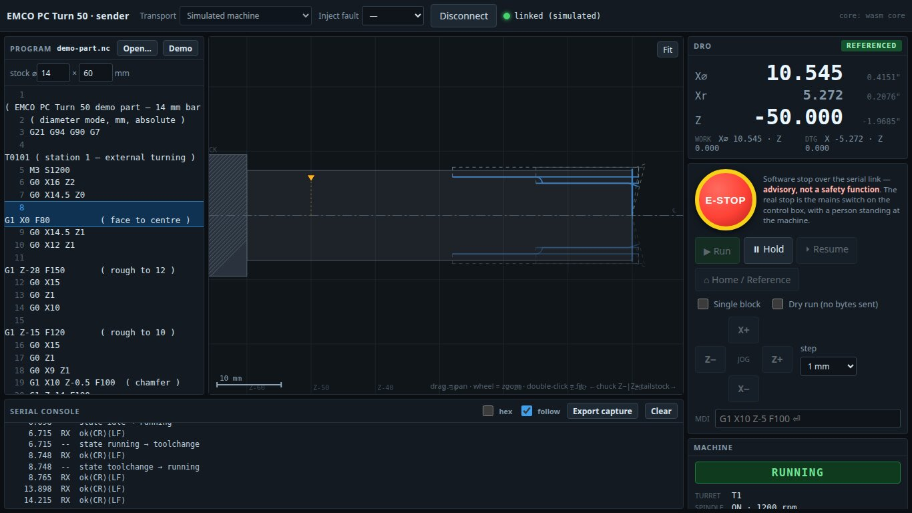

# `sender/` — the G-code sender

The program that would drive the lathe, if we knew how to talk to it.

> **It does not talk to the lathe today.** The machine's protocol is unknown — see
> [`../docs/30-serial-protocol.md`](../docs/30-serial-protocol.md). What works today is the
> **simulated machine**, which is genuinely useful: it is how members learn the sender, and how
> the sender gets developed and tested without hardware.



## Three parts

| | What it is |
| --- | --- |
| [`core/`](core/) | Rust → WASM. G-code parsing, lathe backplot geometry, the protocol dialects, and a virtual machine. Pure and synchronous: no I/O, no clock, no DOM — so it is tested natively with `cargo test` and no browser. |
| [`web/`](web/) | TypeScript + Vite. The operator interface: DRO, toolpath, program pane, jog, MDI, serial console. Owns all I/O and drives the core. |
| [`cli/`](cli/) | A headless Python sender, for when a Chromium browser is not available. |

[`INTERFACE.md`](INTERFACE.md) is the contract between `core` and `web`. It is binding: both
sides are written against it, and it changes before the code does.

## Running it

```sh
nix develop                       # Rust, wasm-pack, Node, Python
cd sender/web && npm ci && npm run dev
```

Open the printed URL in **Chrome or Edge**, leave the transport on **Simulated machine**, press
Connect, then Home, then load a program from [`../gcode/`](../gcode/).

```sh
cd sender/core && cargo test      # 113 tests, no browser needed
cd sender/web  && npm test        # 70 tests, headless
```

## Why the browser, and what it costs

A static page needs nothing installed on the shop PC — no Python environment, no serial driver
stack, no packaging. It also means the same build runs as a training tool on any laptop.

The cost is that **Web Serial is Chromium-only** (Firefox and Safari do not implement it) and
needs `localhost` or HTTPS. `cli/` exists for the cases that rules out.

## If you connect it to the real machine

**Use a USB-RS485 adapter.** The control box's DB9 is connector `X300` carrying a differential
RS-485 bus — pin 2 GND, pin 3 DATA−, pin 8 DATA+. A USB-RS232 cable is the wrong electrical
standard for it and risks damage. See [`../docs/20-control-architecture.md`](../docs/20-control-architecture.md).

Even then, nothing will happen: the framing is unknown. The console's transcript export is
deliberately good, because capturing what the bus does is the actual job right now.

## Safety

The E-STOP button sends whatever stop the dialect offers and drops the link. **It is advisory,
not a safety function.** The real stop is the mains switch on the control box, with a person
standing at the machine. Nothing here should be used to run the lathe unattended or remotely,
and no feature that would encourage it belongs in this directory.
